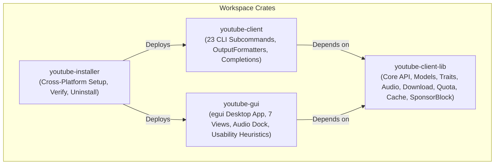

# YouTube Client Workspace (v0.2.0)

[](https://github.com/clockworkengineer/youtube-client/actions/workflows/ci.yml)
[](Cargo.toml)
[](LICENSE)
[](docs/development_and_testing.md)
[](docs/cli_reference.md)

A modular, high-performance Rust workspace engineered under **SOLID Clean Architecture** and **Jakob Nielsen's 10 Usability Heuristics**, providing YouTube Data API v3 integration, a native 60 FPS desktop GUI application (`youtube-gui`), a 23-subcommand CLI client (`youtube-client`), and a cross-platform system installer (`youtube-installer`).

---

## Workspace Structure



* **[`youtube-client-lib`](youtube-client-lib/)**: Core asynchronous library handling YouTube Data API v3 authentication (OAuth2 & API Key), subscriptions, feeds, filtered search, playlists, comments, quality-controlled media downloads (`DownloadOptions`), background audio decoding, API quota budget tracking, SponsorBlock integration, MPV IPC control, and pluggable player/importer registries.
* **[`youtube-gui`](youtube-gui/)**: Fast, lightweight native desktop application built with `egui` and `eframe`. Features 7 primary views (`Subscriptions`, `New Videos`, `Playlists`, `Library`, `History`, `Settings`, `About & Help`), `🎧 Listen` background audio extraction & caching with real-time buffering percentages, SponsorBlock color-coded timeline visualization, resolution/bitrate download pickers, automated error diagnosis banners, and full keyboard shortcut navigation.
* **[`youtube-client`](youtube-client/)**: Feature-rich CLI application exposing **23 subcommands** (including `library`, `history`, `export-subscriptions`, `import-subscriptions`, `playlist-update`, `playlist-remove-video`), pluggable output formatters (`TableFormatter`, `JsonFormatter`, `CsvFormatter`), shell auto-completions, and structured piping for terminal workflows and shell scripting.
* **[`youtube-installer`](youtube-installer/)**: Dedicated installation and lifecycle utility supporting standalone pre-built distributions, automated deployments (`--yes`), Windows Add/Remove Programs integration, health verification (`--verify`), and clean uninstallation (`--uninstall`).

---

## SOLID Clean Architecture Highlights

The workspace is refactored across 5 distinct SOLID phases:
1. **Dependency Inversion & Liskov Substitution (DIP & LSP):** Core services implement segregated traits (`VideoService`, `SubscriptionService`, `PlaylistService`, `CommentService`). The composite `YoutubeApiService` and `YoutubeBackend` adapter support seamless switching between live network execution and in-memory `MockYoutubeClient` for offline testing.
2. **Pluggable Media Players (OCP):** External media players implement the `MediaPlayer` trait (`MpvPlayer`, `VlcPlayer`, `IinaPlayer`, `CustomExecutablePlayer`, `SystemDefaultPlayer`) orchestrated by a prioritized `PlayerRegistry`.
3. **Multi-Format Subscription Importers (OCP & Strategy Pattern):** Standardized `SubscriptionFormat` strategies support importing and exporting subscriptions across OPML XML, Google Takeout CSV (`subscriptions.csv`), and NewPipe JSON.
4. **Decoupled GUI Domain Handlers (SRP & ISP):** GUI event dispatching is partitioned into dedicated domain handlers (`auth`, `navigation`, `playback`, `download`, `settings`, `library`) and 12 modular view files under `youtube-gui/src/views/`.
5. **Decoupled CLI Output Formatters (SRP & OCP):** Terminal presentation is separated from API querying via the `OutputFormatter<T>` trait, providing formatted tables, pretty JSON, and RFC-4180 CSV outputs.

See [SOLID Architecture Specification](docs/solid_architecture.md) for complete details.

---

## Quick Start

### 1. Build or Install via Installer

Run the interactive installer to compile release binaries and configure system shortcuts and `PATH`:
```bash
cargo run --bin youtube-installer
```
Or perform an unattended automated install:
```bash
cargo run --bin youtube-installer -- --yes
```
Alternatively, on Windows, download and execute the standalone installer `youtube-client-setup-0.2.0.exe` built via Inno Setup.

### 2. Run the Native GUI App

```bash
cargo run --bin youtube-gui
```

### 3. Run the CLI Client

```bash
# Authenticate
cargo run --bin youtube-client -- login

# Search videos with sort and duration filters
cargo run --bin youtube-client -- search --query "Rust async" --order view-count --duration medium --limit 5

# Stream all subscriptions as JSON for piping to jq
cargo run --bin youtube-client -- subscriptions --all --json | jq '.[].title'

# Export subscriptions to OPML XML
cargo run --bin youtube-client -- export-subscriptions --output subscriptions.opml

# Download 320 kbps MP3 audio track
cargo run --bin youtube-client -- download --video-id dQw4w9WgXcQ --format mp3 --audio-quality 320

# Browse offline downloaded media library and watch history
cargo run --bin youtube-client -- library
cargo run --bin youtube-client -- history --limit 10
```

---

## Key Features

* 🔐 **OAuth2 & API Key Access**: Secure browser-based authentication, headless device-code flow (`--device-code`), and zero-OAuth read-only access via `--api-key`.
* 🛡️ **SponsorBlock Timeline & Native MPV EDL**: Visualizes color-coded SponsorBlock segments (`sponsor`, `selfpromo`, `interaction`, `intro`, `outro`) on a timeline bar in Video Details and skips them natively in MPV (`edl://`).
* 🎧 **One-Click `🎧 Listen` Audio Streaming & Dock**: Extracts and caches compatible `.mp3` / `.m4a` streams into `%TEMP%/youtube-client-audio/` with live buffering percentages (`🎧 Buffering audio... (N%)`), cooperative `CancellationToken` aborting (`⏹ Cancel Audio`), timeline scrubbing, and `⏪ 10s` / `⏩ 10s` skip controls.
* 📁 **Offline Media Library & Watch History Views**: Dedicated GUI tabs (`📁 Library` `Alt+4`, `⏱ History` `Alt+5`) and CLI subcommands (`library`, `history`) for managing local downloads and resuming watched videos.
* 🔍 **Advanced Search Filters & Recent Search Chips**: Filter searches by Sort Order, Duration, Resource Type, and Upload Date presets, with clickable recent search pills (`🕒 Recent:`).
* 📥 **Selectable Video Resolution & Audio Bitrate**: Choose target resolution (`best`, `2160p`..`360p`) and MP3 bitrate (`best`, `320k`..`128k`) in Settings, Video Details download menus, and CLI flags (`--resolution`, `--audio-quality`).
* 🧭 **Jakob Nielsen's 10 Usability Heuristics**: Plain-language error diagnosis banners with one-click recovery actions (`diagnose_error`), two-step destructive confirmation prompts, `↩ Undo Dismiss` stack, contextual `ⓘ` help badges, and global keyboard shortcuts (`Alt+1..7`, `Ctrl+F`/`/`, `F5`/`Ctrl+R`, `Space`, `Esc`, `Ctrl+S`).
* 👍 **Return YouTube Dislike (RYD) Integration**: Non-blocking public API lookup displaying restored community dislike counts and like/dislike ratios across CLI details and GUI cards.
* 📊 **API Quota Budget Tracking & Zero-Quota RSS Fallback**: Tracks daily 10,000-unit usage with UTC rollover and automatically falls back to public YouTube Atom XML feeds (`quick-xml`) when quota is exhausted.
* 🧪 **86 Automated Tests**: Comprehensive unit, integration, GUI usability, and doc-tests executing with 0 live API credentials using `MockYoutubeClient`.

---

## Documentation Index

The `docs/` directory contains 12 comprehensive specifications and user guides:

| Guide | Description |
| :--- | :--- |
| 📖 [CLI Reference Manual](docs/cli_reference.md) | Exhaustive guide to all **23 subcommands**, filter flags, `OutputFormatter`, JSON output, and `jq` pipelining. |
| 🖥️ [Desktop GUI User Guide](docs/gui_user_guide.md) | Tour of the **7 primary GUI views**, Library & History tabs, SponsorBlock timeline, `🎧 Listen` audio streaming, and Settings. |
| ⌨️ [Usability Heuristics & Shortcuts Guide](docs/usability_and_shortcuts.md) | Jakob Nielsen's 10 Usability Heuristics mapping, global keyboard shortcuts (`Alt+1..7`, `Ctrl+F`, `F5`), error diagnosis, and confirmation safeguards. |
| 📦 [Subscription Backup & Migration Guide](docs/backup_and_migration.md) | Exporting, previewing, and migrating subscriptions across OPML XML, Google Takeout CSV, and NewPipe JSON via CLI & GUI. |
| ⚙️ [Configuration & Secrets Guide](docs/configuration.md) | 6-tier configuration hierarchy, complete 16-field `config.json` schema, and persistent state files. |
| 🔑 [Google OAuth2 Credentials Setup](docs/google_setup.md) | Step-by-step setup in Google Cloud Console with all required API scopes. |
| 🎥 [Video & Audio Playback Guide](docs/video_playback.md) | Configuring MPV, VLC, IINA, SponsorBlock EDL skipping, start offsets, and `🎧 Listen` Rodio audio caching. |
| 💿 [Installation & Packaging Guide](docs/installation_and_packaging.md) | Using `youtube-installer`, Inno Setup Windows installer, and GitHub Actions release workflows. |
| 🏗️ [Architecture & Design Specification](docs/architecture.md) | Workspace design, component topology, concurrency model, and 10 quality attributes. |
| 🏛️ [SOLID Architecture Specification](docs/solid_architecture.md) | In-depth breakdown of the 5 SOLID refactoring phases, design patterns, and extension recipes. |
| 📊 [Caching & API Quota Guide](docs/caching_and_quota.md) | YouTube API quota economics across all 23 subcommands, `QuotaTracker`, TTL cache, and public RSS Atom feed fallback. |
| 🛠️ [Developer & Testing Guide](docs/development_and_testing.md) | Environment setup, **86 passing tests**, `MockYoutubeClient`, GUI usability tests, Clippy standards, and CI pipelines. |

---

## Support & Donation

If you find this project useful and want to support its ongoing development, consider buying me a coffee!

[](https://buymeacoffee.com/roberttizz1)

[☕ Support on Buy Me a Coffee](https://buymeacoffee.com/roberttizz1)
