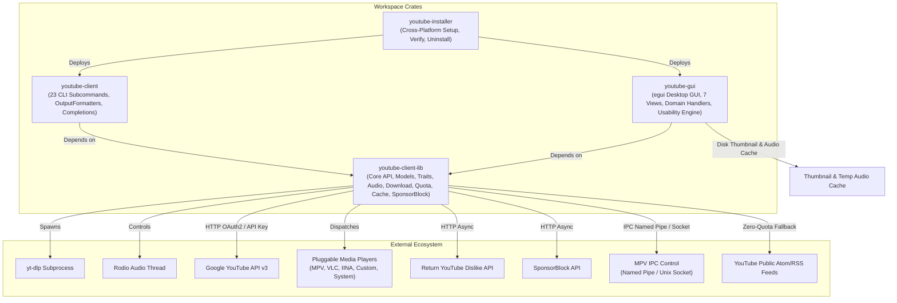
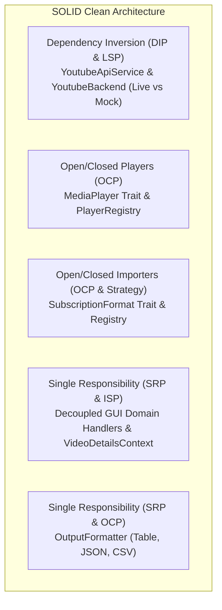
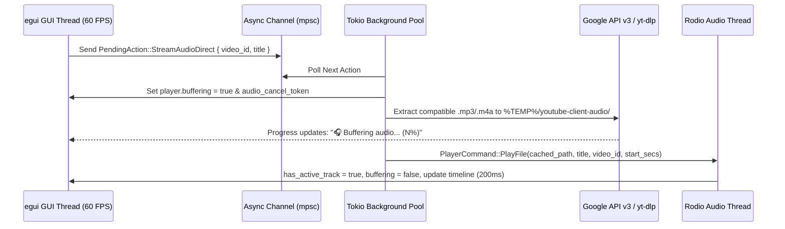
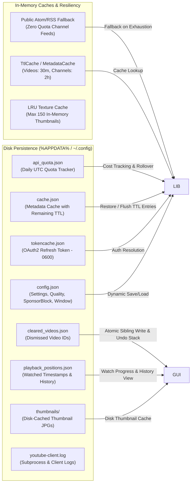

# Workspace Architecture & Design Specification (v0.2.0)

This document details the architectural design, component topology, concurrency model, persistence subsystems, usability engineering, and security boundaries across the `youtube-client` workspace.

---

## 1. System Topology & Crate Hierarchy

The workspace is structured as a Cargo workspace with four specialized crates adhering to strict separation of concerns and Clean Architecture:

### Crate Roles & Feature Flags

1. **`youtube-client-lib`**: Pure asynchronous library providing authentication (OAuth2 & API Key), YouTube Data API v3 bindings, media downloading abstractions with resolution/bitrate constraints & cooperative cancellation (`DownloadOptions`), background audio decoding, retry logic, configuration resolution, quota budget tracking, disk-persistent TTL caching, SponsorBlock EDL segment generation, MPV IPC player controls, and pluggable player/importer registries.
   - **Feature Flags**:
     - `importers`: OPML, Google Takeout CSV, and NewPipe JSON subscription parsing and serialization.
     - `sponsorblock`: SponsorBlock segment retrieval (`https://sponsor.ajay.app/api/skipSegments`) and MPV EDL formatting.
     - `ipc`: Cross-platform MPV IPC controller over Windows named pipes and Unix sockets.
     - `full`: Enables all optional modules.
2. **`youtube-client`**: Command-line interface wrapping `youtube-client-lib`. Built with `clap`, supporting **23 subcommands** (`login`, `subscriptions`, `videos`, `search`, `rate`, `playlists`, `download`, `play`, `details`, `channel`, `comments`, `comment-post`, `subscribe`, `unsubscribe`, `export-subscriptions`, `import-subscriptions`, `playlist-create`, `playlist-delete`, `playlist-remove-video`, `playlist-update`, `library`, `history`, `completions`), pluggable output formatters (`OutputFormatter<T>`: Table, JSON, CSV), zero-OAuth `--api-key` access, headless `login --device-code` authentication, and shell auto-completion generation.
3. **`youtube-gui`**: Desktop graphical application built using `eframe` and `egui`. Features 7 top-level navigation views (`Subscriptions`, `New Videos`, `Playlists`, `Library`, `History`, `Settings`, `About & Help`), decoupled domain action handlers (`handlers/auth`, `handlers/playback`, `handlers/download`, `handlers/settings`, `handlers/library`, `handlers/navigation`), integrated `rodio` audio dock with `🎧 Listen` background extraction & buffering progress, SponsorBlock timeline visualization, resolution/bitrate download menus, and full adherence to Jakob Nielsen's 10 Usability Heuristics.
4. **`youtube-installer`**: Standalone installation and system lifecycle management binary capable of compiling release binaries, configuring user `PATH` environment variables, creating shortcuts, verifying installations (`--verify`), and performing clean removals (`--uninstall`).

---

## 2. SOLID Architectural Pillars

The workspace is organized around the five foundational SOLID principles:

### 1. Dependency Inversion & Liskov Substitution (DIP & LSP)
- **Composite Trait:** [`YoutubeApiService`](file:///c:/Projects/youtube-client/youtube-client-lib/src/traits/mod.rs) unifies domain service traits (`VideoService + SubscriptionService + PlaylistService + CommentService + Send + Sync`).
- **Adapter Pattern:** [`YoutubeBackend`](file:///c:/Projects/youtube-client/youtube-client-lib/src/backend.rs) wraps either `Live(Arc<YoutubeClient>)` or `Mock(MockYoutubeClient)`. Both variants implement all domain traits identically, enabling consumer applications (`youtube-gui` and `youtube-client`) to operate polymorphically without runtime trait object boxing overhead.
- **Offline Mock Injection:** `CliContext::with_mock` and `AppState::with_mock_backend` allow end-to-end integration and UI testing without live Google API keys or network access.

### 2. Pluggable Media Players (Open/Closed Principle)
- **Trait Contract:** [`MediaPlayer`](file:///c:/Projects/youtube-client/youtube-client-lib/src/player.rs) defines a unified launch interface for files and streams.
- **Implementations:** `MpvPlayer` (with `--force-window=immediate`), `VlcPlayer`, `IinaPlayer`, `CustomExecutablePlayer`, and `SystemDefaultPlayer`.
- **Registry:** [`PlayerRegistry`](file:///c:/Projects/youtube-client/youtube-client-lib/src/player.rs) auto-detects system player availability, matches user preferences, and propagates start offsets (`--start` for MPV, `--start-time` for VLC).

### 3. Pluggable Subscription Formats (Strategy Pattern)
- **Trait Contract:** [`SubscriptionFormat`](file:///c:/Projects/youtube-client/youtube-client-lib/src/importers.rs) defines format identification, content detection (`can_parse`), parsing, and serialization.
- **Implementations:** `OpmlFormat` (standard RSS/FreeTube/NewPipe OPML XML), `TakeoutCsvFormat` (Google Takeout `subscriptions.csv`), and `NewPipeJsonFormat`.
- **Universal Registry:** [`SubscriptionFormatRegistry`](file:///c:/Projects/youtube-client/youtube-client-lib/src/importers.rs) auto-detects file format on import without manual file format selection.

### 4. Decoupled GUI Domain Handlers & Views (SRP & ISP)
- **Domain Handlers:** Event dispatching is partitioned into focused modules under [`youtube-gui/src/handlers/`](file:///c:/Projects/youtube-client/youtube-gui/src/handlers/):
  - `auth.rs`: Authentication, OAuth triggers, token cache purging, and account disconnection.
  - `navigation.rs`: View routing (`navigate_to`), history back-navigation (`view_stack`), and view state initialization.
  - `playback.rs`: `StreamAudioDirect` (`🎧 Listen`) audio extraction & caching in `%TEMP%/youtube-client-audio`, local Rodio dispatch, external player execution with start offsets and SponsorBlock EDL URLs, and browser URL opening.
  - `download.rs`: Asynchronous media downloading via `yt-dlp` with resolution/bitrate options and progress state management.
  - `settings.rs`: Settings persistence and runtime directory synchronization.
  - `library.rs`: Subscriptions, channels, playlists, video details, comments pagination, ratings, and OPML/CSV/JSON imports/exports.
- **Dedicated View Modules (`youtube-gui/src/views/`):**
  - `login_view.rs`, `subscriptions_view.rs`, `new_videos_view.rs`, `playlists_view.rs`, `playlist_videos_view.rs`, `channel_view.rs`, `search_view.rs`, `details_view.rs`, `library_view.rs`, `history_view.rs`, `settings_view.rs`, `about_view.rs`, and shared usability/diagnostic helpers in `views.rs`.

### 5. Decoupled Terminal Output Formatters (SRP & OCP)
- **Trait Contract:** [`OutputFormatter<T>`](file:///c:/Projects/youtube-client/youtube-client/src/formatters.rs) separates data fetching from terminal presentation.
- **Implementations:**
  - `JsonFormatter`: Generic pretty-printed JSON serialization for any `serde::Serialize` model.
  - `CsvFormatter`: RFC-4180 compliant CSV export with proper escaping for `Video`, `Subscription`, `Playlist`, and `Comment`.
  - `TableFormatter`: Aligned tabular layouts and ASCII cards.

### 6. Media Engine Resilience & Player Extensibility
- **Native SponsorBlock Skipping ([`sponsorblock.rs`](file:///c:/Projects/youtube-client/youtube-client-lib/src/sponsorblock.rs)):** Retrieves crowd-sourced skip segments (`sponsor`, `intro`, `outro`, `selfpromo`, `interaction`, `preview`, `music_offtopic`, `filler`), renders color-coded timeline bars in `details_view.rs`, and synthesizes native MPV EDL (`edl://`) stream URLs.
- **Bi-directional MPV IPC Client ([`mpv_ipc.rs`](file:///c:/Projects/youtube-client/youtube-client-lib/src/mpv_ipc.rs)):** Controls running MPV instances over Windows named pipes (`\\.\pipe\mpvsocket-...`) and Unix domain sockets (`/tmp/mpvsocket-...`).
- **Cooperative Download & Audio Buffering Cancellation ([`download.rs`](file:///c:/Projects/youtube-client/youtube-client-lib/src/download.rs), [`playback.rs`](file:///c:/Projects/youtube-client/youtube-gui/src/handlers/playback.rs)):** Emits structured [`DownloadProgress`](file:///c:/Projects/youtube-client/youtube-client-lib/src/download.rs) events with percentage, transfer speed, and ETA calculations, honoring cooperative abort tokens via `tokio_util::sync::CancellationToken` for both downloads and `🎧 Listen` audio buffering.
- **Cached Compatible Audio Streaming (`StreamAudioDirect`):** Extracts `.mp3` (with `.m4a` fallback when `ffmpeg` is absent) into `%TEMP%/youtube-client-audio/<video_id>.mp3` and dispatches `PlayerCommand::PlayFile` to the dedicated `rodio` thread while preserving buffering UI state via `has_active_track`.

---

## 3. Concurrency & Threading Model

The application coordinates multiple execution runtimes to prevent UI blocking:

1. **GUI Frame Loop (egui):** Synchronous, immediate-mode rendering loop running on the main UI thread. Processes global keyboard shortcuts (`Alt+1..7`, `Ctrl+F`, `F5`, `Space`, `Esc`, `Ctrl+S`) and renders views without blocking network or disk I/O.
2. **Tokio Async Worker Pool:** Background task manager handling network requests, API queries, SponsorBlock lookups, subprocess spawning (`yt-dlp`), and thumbnail image fetching.
3. **Rodio Audio Engine (`youtube-gui/src/player.rs`):** Dedicated hardware audio thread running via `rodio::OutputStream` and `rodio::Sink`. Tracks `has_active_track` so its 200ms status loop only clears playback flags when an active track finishes, never clobbering async buffering states.

---

## 4. Persistence, Caching & Quota Architecture

* **LRU Texture Cache (`AppState::MAX_THUMBNAILS`):** In-memory FIFO/LRU queue tracking loaded `egui::TextureHandle` instances capped at **150 items**, backed by persistent disk files in `thumbnails/`.

---

## 5. Implementation of the 10 Quality Attributes

| Attribute | Implementation Details |
| :--- | :--- |
| **1. Intuitive API & UI Design** | Fluent builder [`YoutubeClientBuilder`](file:///c:/Projects/youtube-client/youtube-client-lib/src/builder.rs); strongly typed models; GUI engineered around Jakob Nielsen's 10 Usability Heuristics ([`USABILITY_AND_SHORTCUTS.md`](USABILITY_AND_SHORTCUTS.md)). |
| **2. Comprehensive Documentation** | Complete rustdoc with executable doc-tests; 12 specialized markdown guides in `docs/`; 4 standalone runnable examples in `examples/`. |
| **3. High Reliability & Resilience** | Exponential backoff with jitter ([`retry_api_call`](file:///c:/Projects/youtube-client/youtube-client-lib/src/retry.rs)); atomic sibling file writes ([`write_json_atomically`](file:///c:/Projects/youtube-client/youtube-client-lib/src/utils.rs)); mutex poison recovery; cooperative `CancellationToken` aborting; automated error diagnosis banners (`diagnose_error`). |
| **4. Performance & Efficiency** | Capped LRU texture queue (150 textures); lazy stream pagination (`BoxStream<'a, T>`); chunked batch video fetching (`get_videos_batch`); persistent disk metadata & audio stream caching. |
| **5. Maintainability** | Segregated service traits; decoupled domain handlers (`handlers/`); isolated presentation (`OutputFormatter`); modular view files (`views/`). |
| **6. Flexibility & Customization** | Pluggable media player registry; selectable video resolution & audio bitrates; SponsorBlock EDL generation; MPV IPC control; multi-format subscription importers. |
| **7. Strong Security** | Filename sanitization ([`sanitize_filename`](file:///c:/Projects/youtube-client/youtube-client-lib/src/utils.rs)); command injection protection; sensitive token permissions (`0600`); zero-OAuth API key support. |
| **8. High Testability** | In-memory [`MockYoutubeClient`](file:///c:/Projects/youtube-client/youtube-client-lib/src/testing/mod.rs); **86 automated unit, integration, and doc tests** across all 4 crates; offline CLI/GUI testing via `YoutubeBackend`. |
| **9. Compatibility & Portability** | Centralized standard OS app data directories (`%APPDATA%`, `~/.config`); cross-platform media player discovery; cross-platform named pipe/Unix socket IPC. |
| **10. Low Dependency Footprint** | Modular feature flags on `youtube-client-lib`; lightweight immediate-mode `egui` rendering. |
