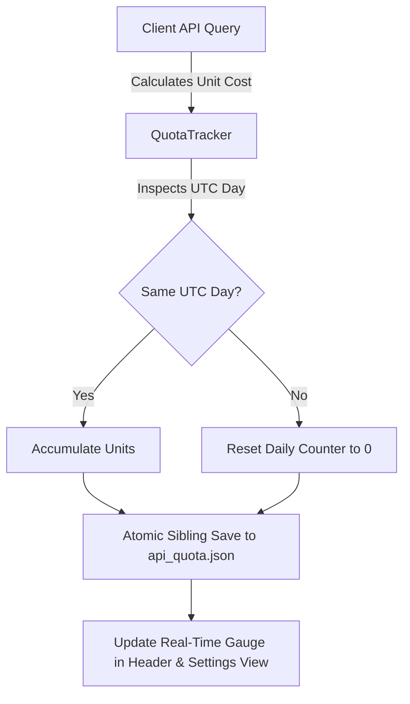

# API Quota Management, Caching & Resiliency Guide

**Workspace:** `youtube-client`  
**Target Version:** 0.3.0  

---

## 1. YouTube Data API v3 Quota Economics

The YouTube Data API v3 enforces a strict daily quota limit (typically **10,000 units per day** on free tier developer projects). Different API and local operations incur vastly different quota costs:

| Operation / CLI Subcommand | Typical Endpoint / Source | Quota Unit Cost | Notes |
| :--- | :--- | :---: | :--- |
| **Search Queries (`search`)** | `/youtube/v3/search` | **100 units** | Expensive. 100 searches exhausts the entire daily quota. |
| **Video Metadata Reads (`details`, `videos`)** | `/youtube/v3/videos?part=snippet,statistics` | **1 unit** | Inexpensive; cached for 30m in `TtlCache`. |
| **Channel Profile Reads (`channel`)** | `/youtube/v3/channels?part=snippet,statistics` | **1 unit** | Inexpensive; cached for 2h in `TtlCache`. |
| **Subscriptions List (`subscriptions`, `export-subscriptions`)** | `/youtube/v3/subscriptions?part=snippet` | **1 unit / page** | 1 unit per page of up to 50 channels. |
| **Playlist & Item Reads (`playlists`)** | `/youtube/v3/playlists`, `/youtube/v3/playlistItems` | **1 unit** | Inexpensive. |
| **Comment Thread Reads (`comments`)** | `/youtube/v3/commentThreads` | **1 unit / page** | 1 unit per page of comments. |
| **Comment Post (`comment-post`)** | `/youtube/v3/commentThreads` (POST) | **50 units** | Write mutation. |
| **Video Rating (`rate`)** | `/youtube/v3/videos/rate` (POST) | **50 units** | Write mutation. |
| **Subscribe / Unsubscribe (`subscribe`, `unsubscribe`, `import-subscriptions`)** | `/youtube/v3/subscriptions` (POST/DELETE) | **50 units / sub** | Write mutation (~190–200 max per day). |
| **Playlist Mutations (`playlist-create`, `playlist-delete`, `playlist-update`, `playlist-remove-video`)** | `/youtube/v3/playlists`, `/youtube/v3/playlistItems` | **50 units** | Write mutation. |
| **Public RSS Atom Fallback** | `https://www.youtube.com/feeds/videos.xml` | **0 units** | Completely free; zero API keys required. |
| **Return YouTube Dislike (RYD) Lookup** | `https://returnyoutubedislikeapi.com/votes` | **0 units** | Third-party community API; zero Google quota cost. |
| **SponsorBlock Segment Lookup** | `https://sponsor.ajay.app/api/skipSegments` | **0 units** | Crowd-sourced API; zero Google quota cost. |
| **Local Library, History & Downloads (`library`, `history`, `download`, `play`)** | Local disk / `yt-dlp` subprocess | **0 units** | Zero Google API quota consumption. |

Without active budget tracking and caching, desktop clients can easily exhaust their daily budget within hours of regular browsing.

---

## 2. The `QuotaTracker` Subsystem

`youtube-client-lib` includes an autonomous [`QuotaTracker`](file:///c:/Projects/youtube-client/youtube-client-lib/src/quota.rs) that records API consumption locally:



### Key Behaviors:
1. **Daily UTC Rollover:** `QuotaTracker` tracks the current date in UTC (`YYYY-MM-DD`). Upon detecting a new UTC calendar day, it automatically resets the daily counter to zero.
2. **Atomic Persistence:** Quota metrics are saved atomically to `%APPDATA%/youtube-client/api_quota.json` (or `~/.config/youtube-client/api_quota.json`).
3. **Usage Breakdown:** Records searches, read queries, mutations, and total units consumed.
4. **Exhaustion Guard:** Emits visual warnings in the GUI top bar and Settings view when usage crosses 50% (Amber) and 80% (Red) of the daily limit.

---

## 3. In-Memory & Disk-Backed TTL Metadata Caching (`TtlCache` & `MetadataCache`)

To eliminate redundant network calls, `youtube-client-lib` provides [`TtlCache<K, V>`](file:///c:/Projects/youtube-client/youtube-client-lib/src/cache.rs) backed by disk persistence in `cache.json`:

### Cache Configurations

1. **Video Metadata Cache:**
   - **Key:** Video ID (`String`)
   - **Value:** `VideoDetails`
   - **TTL:** 30 minutes
   - Prevents re-fetching identical video descriptions, statistics, and tags when navigating back and forth between feeds, search results, watch history, and details views.
2. **Channel Profile Cache:**
   - **Key:** Channel ID (`String`)
   - **Value:** `ChannelDetails`
   - **TTL:** 2 hours
   - Eliminates repeated queries when browsing multiple uploads from the same creator.

### Cache Mechanics
* Thread-safe access via `Arc<RwLock<...>>`.
* Stale entries are lazily evicted on lookup or proactively pruned during periodic cleanup.
* Automatically disabled in `MockYoutubeClient` during testing to ensure deterministic test assertions.

---

## 4. Zero-Quota Public RSS Atom XML Fallback

When viewing uploads from a channel or refreshing the `🆕 New Videos` feed, `youtube-client-lib` provides a zero-quota fallback mechanism via public YouTube Atom/RSS feeds:

```
https://www.youtube.com/feeds/videos.xml?channel_id=<CHANNEL_ID>
```

### Capabilities & Guarantees:
* **0 Quota Consumption:** Requires zero YouTube Data API keys and zero quota units.
* **Parsed via [`parse_youtube_rss_xml`](file:///c:/Projects/youtube-client/youtube-client-lib/src/rss.rs):** Extracts video IDs, titles, publication dates, and highest-resolution media thumbnails.
* **Automatic Fallback:** In `youtube-gui`, if the YouTube Data API returns an HTTP 403 quota exhaustion error or network failure, the application automatically falls back to public RSS feeds to keep channel video browsing functional.

---

## 5. Real-Time GUI Quota Indicators

Both the **Top Header Bar** and the **`⚙ Settings` View** (`Alt+6`) in `youtube-gui` display real-time API quota consumption:

```
┌─────────────────────────────────────────────────────────────┐
│  📊 Daily API Quota Budget (10,000 units)        [ⓘ Help]   │
├─────────────────────────────────────────────────────────────┤
│  Used: 1,450 / 10,000 units [██████░░░░░░░░░░░░░░░░░] 14.5% │
│                                                             │
│  Status: Healthy (Resets daily at midnight UTC)             │
│  [🔄 Reset Local Counter] (Protected by Confirmation)       │
└─────────────────────────────────────────────────────────────┘
```

Additionally, the **Search View** (`Ctrl+F`) displays a contextual `100 quota units ⓘ` badge next to the search button so users remain aware of search costs before executing queries.
