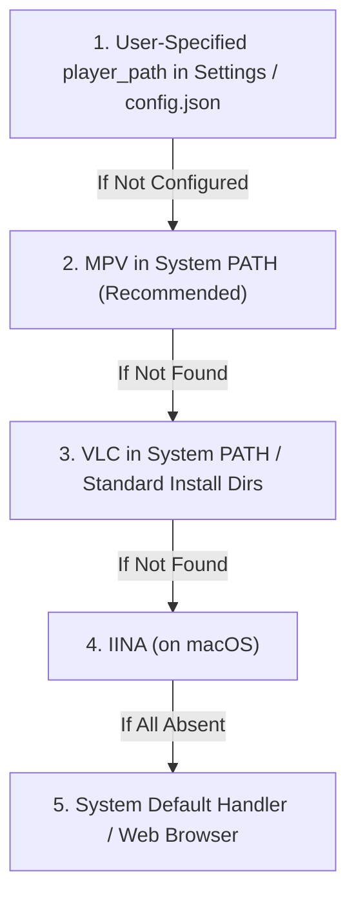
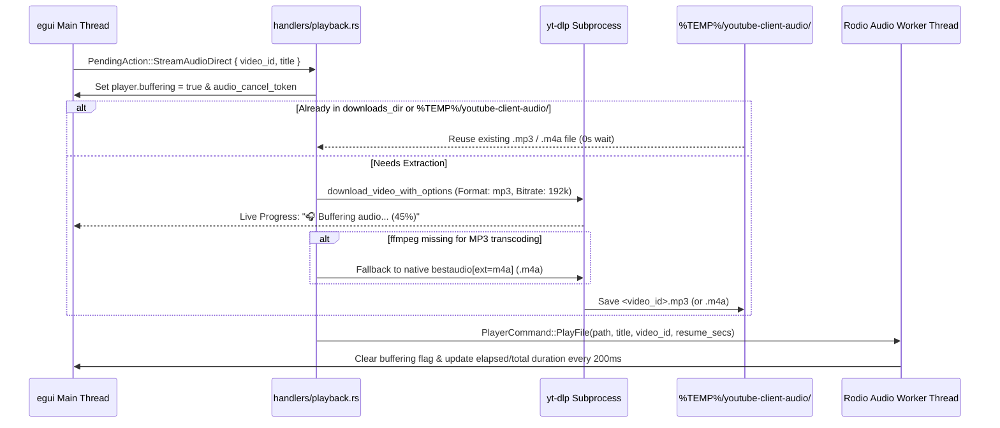

# Video & Audio Playback Architecture Guide (v0.2.0)

The YouTube Client suite provides four complementary avenues for consuming media:
1. **Direct Video Streaming:** Stream online YouTube videos via desktop media players (**MPV**, **VLC**, **IINA**, or custom binaries) with automatic SponsorBlock segment skipping, start-offset resumption, and browser fallback.
2. **Integrated Desktop Audio Engine (`🎧 Listen`):** Stream online or offline audio tracks directly within `youtube-gui` using the built-in **Rodio** hardware audio dock with real-time buffering percentages, `CancellationToken` abort controls, timeline scrubbing, and 10s skip controls.
3. **Command-Line Playback:** Play downloaded audio/video files locally using `youtube-client play`.
4. **Media Downloads:** Extract MP4 video or MP3 audio streams at configurable resolutions (`2160p`..`360p`) and bitrates (`320k`..`128k`) via `yt-dlp` using `youtube-client download` or the GUI download selector menus.

---

## 1. Pluggable Media Player Architecture (`MediaPlayer` & `PlayerRegistry`)

Rather than relying on hardcoded process invocations, external player dispatching is governed by the Open/Closed Principle via the [`MediaPlayer`](file:///c:/Projects/youtube-client/youtube-client-lib/src/player.rs) trait:

```rust
pub struct PlayOptions {
    pub start_secs: Option<f32>,
    pub cookies_file: Option<PathBuf>,
    pub cookies_from_browser: Option<String>,
    pub log_file: Option<PathBuf>,
    pub title: Option<String>,
    pub ipc_pipe: Option<String>,
}

pub trait MediaPlayer: Send + Sync {
    fn id(&self) -> &str;
    fn display_name(&self) -> &str;
    fn is_available(&self) -> bool;
    fn launch(&self, target: &OsStr, opts: &PlayOptions) -> Result<std::process::Child, String>;
}
```

### Supported Media Players

| Player | Identifier | Availability Check | Window & Resume Flags | Cookies & IPC Support |
| :--- | :--- | :--- | :--- | :--- |
| **MPV** | `mpv` | `mpv` in system `PATH` | `--no-terminal --force-window=immediate --save-position-on-quit --start=<secs>` | `--ytdl-raw-options-append=cookies=...`, `--input-ipc-server=<pipe>`, `edl://` SponsorBlock URLs |
| **VLC** | `vlc` | `vlc` in system `PATH` or `Program Files\VideoLAN\VLC` | `--start-time=<secs> --meta-title=<title>` | Standard URL / file playback |
| **IINA** | `iina` | `iina` in `PATH` or `/Applications/IINA.app` | `--mpv-start=<secs>` | Forwarded to underlying mpv engine |
| **Custom** | `custom` | User-configured executable path | Auto-detects `mpv` (`--force-window=immediate --start`) or `vlc` (`--start-time`) flags | Forwarded |
| **System** | `system` | Default OS file/URL association | OS default launcher (`start`, `open`, `xdg-open`) | Default desktop handler |

> [!NOTE]
> `MpvPlayer` and `CustomExecutablePlayer` explicitly pass `--force-window=immediate` so MPV immediately opens a visible player window while `yt-dlp` resolves stream URLs or plays audio-only streams, preventing detached headless playback in the background.

### Player Discovery Hierarchy

When streaming a video, [`PlayerRegistry`](file:///c:/Projects/youtube-client/youtube-client-lib/src/player.rs) selects a player according to:



---

## 2. SponsorBlock Integration & MPV EDL Skipping (`sponsorblock.rs`)

`youtube-client-lib` integrates natively with the crowd-sourced [SponsorBlock API](https://sponsor.ajay.app/) via [`youtube-client-lib/src/sponsorblock.rs`](file:///c:/Projects/youtube-client/youtube-client-lib/src/sponsorblock.rs):

1. **Zero-Quota Segment Lookup:** Queries `https://sponsor.ajay.app/api/skipSegments?videoID=<ID>&categories=[...]` asynchronously (`0` YouTube quota units).
2. **Supported Categories:**
   * `sponsor` (Paid promotion / sponsor reads)
   * `selfpromo` (Unpaid or self-promotion)
   * `interaction` (Subscribe / like reminders)
   * `intro` (Intermission / intro animation)
   * `outro` (Endcards / credits)
   * `preview` (Recap / preview)
   * `music_offtopic` (Non-music section in music videos)
   * `filler` (Filler tangent)
3. **Native MPV EDL Synthesis (`build_mpv_edl_url`):**
   When launching a video in MPV with SponsorBlock enabled, `youtube-gui` and `youtube-client-lib` can construct a native MPV Edit Decision List (`edl://`) stream URI that plays only the non-sponsored intervals back-to-back without requiring any external Lua scripts.
4. **Visual Timeline Bar in GUI:**
   In `VideoDetails` (`details_view.rs`), fetched SponsorBlock segments are rendered as color-coded regions along a horizontal timeline bar with hover tooltips displaying the category name and exact `MM:SS – MM:SS` interval.

---

## 3. Direct Audio Streaming (`🎧 Listen`) & Rodio Engine

`youtube-gui` features a native hardware-accelerated audio engine (`youtube-gui/src/player.rs`) running on a dedicated OS thread via `rodio`, paired with an asynchronous stream extractor in [`youtube-gui/src/handlers/playback.rs`](file:///c:/Projects/youtube-client/youtube-gui/src/handlers/playback.rs):



### Key Capabilities of `🎧 Listen`:
* **Compatible Container Extraction (`.mp3` with `.m4a` Fallback):** Because raw YouTube `webm`/`opus` streams cannot be decoded directly by `symphonia`/`rodio`'s default codecs, `StreamAudioDirect` extracts a clean `.mp3` stream (or native AAC `.m4a` if `ffmpeg` is not installed) into `%TEMP%/youtube-client-audio/<video_id>.mp3`.
* **Instant Cache Reuse:** Re-clicking `🎧 Listen` on a previously buffered or downloaded track plays immediately from disk without re-downloading.
* **Real-Time Progress & Cooperative Cancellation:** While buffering, the header bar and Video Details view display live download percentages (`🎧 Buffering audio... (45%)`) and an immediate **`⏹ Cancel Audio`** button backed by `tokio_util::sync::CancellationToken`.
* **State Preservation Guard (`has_active_track`):** The background `rodio` polling loop in `youtube-gui/src/player.rs` tracks `has_active_track` so its 200ms idle timer never overwrites the UI's `buffering = true` state while `yt-dlp` is still extracting audio.
* **Interactive Timeline Scrubber & Skip Controls:** Once playing, use the bottom audio dock to Play/Pause (`Space`), Stop (`⏹`), skip `⏪ 10s` / `⏩ 10s`, drag the timeline slider, or adjust volume (`0%–100%`).

---

## 4. Watch Progress Tracking & Resume Playback

`youtube-gui` continuously tracks playback progress to ensure seamless resumption:
1. **Timestamp Persistence:** Every 200ms of playback, the current position (`position_secs`, `duration_secs`, `title`, `updated_at`) is synchronized and written atomically to `%APPDATA%/youtube-client/playback_positions.json` (or `~/.config/youtube-client/playback_positions.json`).
2. **Resume Badges & History View (`Alt+5`):** Feeds, video details, and the dedicated **`⏱ History`** view display a progress bar and `⏱ Watched to MM:SS` badge.
3. **Offset Forwarding:**
   - **Internal Audio (`rodio`):** Seeks directly to the saved offset on load.
   - **MPV:** Launches with `--start=<seconds>`.
   - **VLC:** Launches with `--start-time=<seconds>`.
4. **Auto-Cleanup:** Upon reaching 95% completion or track end, the resume marker is automatically cleared.

---

## 5. Configuring Cookies & Bypassing Bot Verification

YouTube periodically enforces server-side stream protection causing unauthenticated `yt-dlp` requests to hit `HTTP 403 Forbidden` or *"Sign in to confirm you’re not a bot"*.

### Solution 1: Update `yt-dlp`
```bash
yt-dlp -U
```

### Solution 2: Browser Cookie Extraction (Recommended)
Select your browser in the **`⚙ Settings`** view (`Alt+6`) in `youtube-gui` or define `"cookies_from_browser"` in `config.json`:
```json
{
  "cookies_from_browser": "firefox"
}
```
Supported values: `chrome`, `firefox`, `edge`, `brave`, `opera`, `vivaldi`. Both `PlayerRegistry` and `download_video_with_options` automatically forward `--cookies-from-browser` to `yt-dlp` and `mpv`.

### Solution 3: Watch in Browser Fallback
Click **"🌐 Watch in Browser"** on any video details page to open the stream in your default web browser.

---

## 6. Command-Line Playback & Quality-Controlled Downloading

### Play Local Media via CLI
```bash
# Play audio locally using Rodio
youtube-client play --file downloads/song.mp3

# Open using the operating system's default media player
youtube-client play --file downloads/video.mp4 --system
```

### Download Media with Resolution & Audio Bitrate Selection
```bash
# Download 1080p MP4 video
youtube-client download --video-id dQw4w9WgXcQ --format mp4 --resolution 1080p

# Download and extract 320 kbps MP3 audio
youtube-client download --video-id dQw4w9WgXcQ --format mp3 --audio-quality 320 --output downloads/rick.mp3
```
